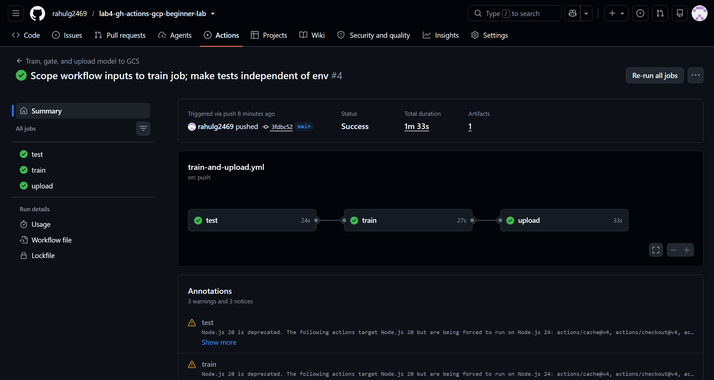
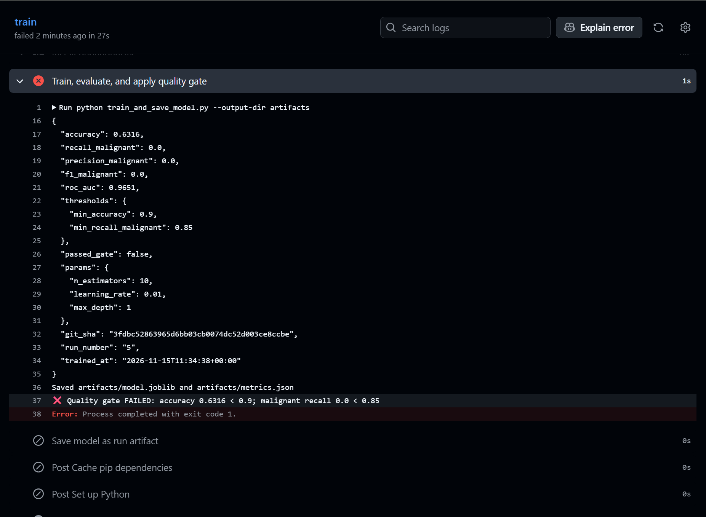

# Lab 4: GitHub Actions + GCP

## Where this started

The starting code for this lab was taken from **[raminmohammadi/MLOps → Labs/Github_Labs/Lab3](https://github.com/raminmohammadi/MLOps/tree/main/Labs/Github_Labs/Lab3)**.

We kept the core idea: train a model inside GitHub Actions and store it in Google Cloud Storage (GCS). We then reworked the CI/CD pipeline and changed both the dataset and the ML model. Everything we changed is explained below.

---

## Table of contents
1. [What the original lab does](#1-what-the-original-lab-does)
2. [What we changed: overview](#2-what-we-changed-overview)
3. [Old vs new: side-by-side](#3-old-vs-new-side-by-side)
4. [Dataset change](#4-dataset-change)
5. [Model change](#5-model-change)
6. [Metrics and the quality gate](#6-metrics-and-the-quality-gate)
7. [How the new pipeline works](#7-how-the-new-pipeline-works)
8. [Requirements](#8-requirements)
9. [Running it on your laptop (first-time setup)](#9-running-it-on-your-laptop-first-time-setup)
10. [Running the full pipeline on GitHub + GCP](#10-running-the-full-pipeline-on-github--gcp)
11. [What a successful run looks like](#11-what-a-successful-run-looks-like)
12. [Demo: watching the quality gate block a bad model](#12-demo-watching-the-quality-gate-block-a-bad-model)
13. [Repo structure](#13-repo-structure)
14. [Troubleshooting](#14-troubleshooting)

---

## 1. What the original lab does

The original lab has one GitHub Actions workflow containing **one job**. It runs daily at midnight or when triggered manually, and it does the following in order:

1. Checks out the code and sets up Python 3.10.
2. Caches and installs pip dependencies.
3. Authenticates to GCP using a service account JSON key stored as a GitHub secret.
4. Runs `train_and_save_model.py`, which trains a **RandomForestClassifier** on the **Iris** dataset, prints accuracy, and uploads the model to GCS with a timestamped filename.

Its limitations:
- **No tests.** Broken code still trains and uploads.
- **No quality check.** The model is uploaded no matter how badly it performs.
- **Silent upload failures.** If the upload fails, the script prints an error but the job still shows green.
- **Credentials everywhere.** Training and uploading happen in the same job, so the GCP credentials are available to every step.
- **Narrow triggers.** It only runs on the schedule or manually, with no reaction to code pushes or pull requests.

## 2. What we changed: overview

**Pipeline changes (the core of the lab):**
1. **Three chained jobs instead of one:** `test` → `train` → `upload`.
2. **Quality gate.** A model that doesn't meet minimum accuracy **and** minimum recall fails the pipeline and is never uploaded.
3. **Versioned uploads.** Every model is stored under a folder named after the exact commit and run that produced it, alongside its metrics. A `latest/` copy always points to the newest one.
4. **More triggers.** The pipeline runs on push to `main`, on pull requests (test and train only, never upload), on the daily schedule, and manually with tunable inputs.

**ML changes:**
5. **Dataset:** Iris → **Breast Cancer Wisconsin**.
6. **Model:** RandomForest → **Gradient Boosting**.
7. **Metrics:** accuracy only → **accuracy, recall, precision, F1, and ROC-AUC**.

**Supporting changes:**
- A `pytest` test suite (6 tests).
- The bucket name moved from a hardcoded value to a GitHub repository variable.
- The training script now works fully offline, so you can run it on your laptop with no cloud account.

## 3. Old vs new: side-by-side

| Area | Original | This version |
|---|---|---|
| Jobs | 1 job does everything | 3 jobs: `test` → `train` → `upload`, chained with `needs:` |
| Testing | None | 6 pytest tests run first; failures stop the pipeline |
| Quality check | None, every model is uploaded | Gate on accuracy ≥ 0.90 **and** malignant recall ≥ 0.85 |
| Who has GCP access | The whole job | Only the `upload` job |
| How the model moves | Uploaded directly from the training script | Saved as a GitHub Actions artifact, then downloaded by the `upload` job |
| Upload method | Python `google-cloud-storage` client | `gcloud storage cp` in the workflow |
| Upload failure | Prints an error, job stays green | Job fails (red) |
| GCS layout | `trained_models/iris_rf_<timestamp>.joblib` | `models/<commit>-run<N>/` (model + metrics) **and** `models/latest/` |
| Metrics saved | None, only printed | `metrics.json` uploaded next to every model |
| Triggers | Daily cron, manual | Daily cron, manual **with inputs**, push to `main`, pull requests |
| PR behavior | N/A | Runs `test` and `train`, **never** uploads |
| Hyperparameters | Hardcoded | Workflow inputs, env vars, or CLI flags |
| Bucket name | Hardcoded default in the script | `GCS_BUCKET_NAME` repository variable |
| Dataset | Iris | Breast Cancer Wisconsin |
| Model | RandomForestClassifier | GradientBoostingClassifier |
| Data split | Random | Stratified (keeps the class balance equal in train and test) |

## 4. Dataset change

| | Iris (original) | Breast Cancer Wisconsin (new) |
|---|---|---|
| Samples | 150 | 569 |
| Features | 4 (petal and sepal measurements) | 30 (cell-nucleus measurements from biopsy images, e.g. radius, texture, smoothness) |
| Classes | 3 flower species | 2: **malignant** (212) vs **benign** (357) |
| Balance | Perfectly balanced | Imbalanced (~37% malignant) |
| Source | Built into scikit-learn | Built into scikit-learn |

**Why we switched:**
- **Iris is too easy.** Almost any model scores 95%+, so a quality gate would never trigger and there would be nothing meaningful to demonstrate.
- **Breast Cancer is a real binary medical problem** with class imbalance, and the two kinds of mistakes have different costs. Missing a malignant tumor is far worse than a false alarm. This gives the quality gate a real reason to exist.
- **It's built into scikit-learn.** There's no download step in CI and nothing external to break.

In scikit-learn's version of this dataset, label `0` = malignant and label `1` = benign. Data is split 80/20 (455 train, 114 test) with stratification and a fixed seed (`random_state=42`), so results are reproducible.

## 5. Model change

| | Original | New |
|---|---|---|
| Model | `RandomForestClassifier(n_estimators=100)` | `GradientBoostingClassifier(n_estimators=100, learning_rate=0.1, max_depth=3)` |
| How it works | Many independent deep trees, averaged | Many small trees built **one after another**, each correcting the previous trees' errors |
| Tunable in the pipeline | No | Yes: `n_estimators`, `learning_rate`, `max_depth` |

**Why Gradient Boosting:**
- It is a strong, widely used choice for tabular data like this.
- Its three main knobs (`n_estimators`, `learning_rate`, `max_depth`) have a visible effect on performance. That makes it a good fit for exposing them as workflow inputs and showing how the quality gate reacts to good and bad settings (see [section 12](#12-demo-watching-the-quality-gate-block-a-bad-model)).
- It needs no extra dependencies, since it's part of scikit-learn.

## 6. Metrics and the quality gate

### Metrics we track

All metrics are computed on the 114-sample test set and saved to `metrics.json`.

| Metric | What it means here | Default run |
|---|---|---|
| **Accuracy** | Share of all test samples classified correctly | **0.9561** (109 / 114) |
| **Recall (malignant)** | Of all truly malignant tumors, how many the model caught | **0.9048** (38 / 42 caught, 4 missed) |
| **Precision (malignant)** | Of everything flagged malignant, how many really were | **0.9744** (38 / 39, 1 false alarm) |
| **F1 (malignant)** | Balance of precision and recall for the malignant class | **0.9383** |
| **ROC-AUC** | How well the model ranks malignant vs benign across all thresholds (1.0 = perfect) | **0.9907** |

These numbers come from the default settings (`n_estimators=100`, `learning_rate=0.1`, `max_depth=3`).

### The quality gate

The model must pass **both** checks, or the `train` job fails and nothing is uploaded:

| Check | Default threshold | Why |
|---|---|---|
| Accuracy | ≥ **0.90** | The model should be right overall |
| Recall on malignant | ≥ **0.85** | The model must not miss too many cancer cases |

Recall gets its own check because accuracy alone can hide dangerous behavior. A model that labels nearly everything "benign" can still score decent accuracy, because most samples are benign, while missing most of the malignant cases.

Both thresholds can be changed per run through the workflow inputs.

### Example `metrics.json`

```json
{
  "accuracy": 0.9561,
  "recall_malignant": 0.9048,
  "precision_malignant": 0.9744,
  "f1_malignant": 0.9383,
  "roc_auc": 0.9907,
  "thresholds": { "min_accuracy": 0.9, "min_recall_malignant": 0.85 },
  "passed_gate": true,
  "params": { "n_estimators": 100, "learning_rate": 0.1, "max_depth": 3 },
  "git_sha": "<commit hash>",
  "run_number": "<run number>",
  "trained_at": "<UTC timestamp>"
}
```

## 7. How the new pipeline works

The workflow file is `.github/workflows/train-and-upload.yml`.

```
 push / PR / schedule / manual
            │
            ▼
   ┌─────────────────┐
   │  test           │  pytest (6 tests)        fail → stop
   └────────┬────────┘
            ▼
   ┌─────────────────┐
   │  train          │  train → evaluate → gate fail → stop (nothing uploaded)
   │  (no GCP access)│  save model as artifact
   └────────┬────────┘
            ▼   (skipped on pull requests)
   ┌─────────────────┐
   │  upload         │  download artifact → auth with GCP →
   │  (only GCP job) │  copy to models/<sha>-run<N>/ and models/latest/
   └─────────────────┘
```

**Triggers:**

| Trigger | `test` | `train` | `upload` |
|---|---|---|---|
| Push to `main` | Runs | Runs | Runs |
| Pull request into `main` | Runs | Runs | Skipped |
| Daily at 00:00 UTC | Runs | Runs | Runs |
| Manual (Run workflow button) | Runs | Runs | Runs |

**Manual run inputs:**

| Input | Default | Meaning |
|---|---|---|
| `n_estimators` | 100 | Number of boosting stages |
| `learning_rate` | 0.1 | How much each new tree contributes |
| `max_depth` | 3 | Depth of each tree |
| `min_accuracy` | 0.90 | Gate threshold for accuracy |
| `min_recall` | 0.85 | Gate threshold for malignant recall |

## 8. Requirements

### To run locally

| Tool | Version | Download |
|---|---|---|
| Python | **3.10** (matches CI; 3.10+ should work) | https://www.python.org/downloads/ |
| Git | any recent version | https://git-scm.com/downloads |

**Windows users:** during Python setup, tick **"Add python.exe to PATH"**. Installing Git also installs **Git Bash**, which you can use to run every command in this README.

### Python packages (`requirements.txt`)

| Package | Used for |
|---|---|
| `pandas` | Dataset handling |
| `scikit-learn` | Dataset, Gradient Boosting model, metrics |
| `joblib` | Saving the trained model |
| `pytest` | Running the test suite |

### To run the full pipeline (additionally)

- A **GitHub** account: https://github.com
- A **Google Cloud** project with billing enabled: https://console.cloud.google.com

You do **not** need the Google Cloud CLI on your laptop. All GCP setup is done in the web console.

## 9. Running it on your laptop (first-time setup)

No cloud account is needed for this part.

**1. Get the code**
```bash
git clone https://github.com/rahulg2469/lab4-gh-actions-gcp-beginner-lab.git
cd lab4-gh-actions-gcp-beginner-lab
```

**2. Create and activate a virtual environment**
```bash
python -m venv venv
```
Then activate it. The command depends on your terminal:

| Terminal | Command |
|---|---|
| macOS / Linux | `source venv/bin/activate` |
| Windows: Git Bash | `source venv/Scripts/activate` |
| Windows: Command Prompt | `venv\Scripts\activate` |
| Windows: PowerShell | `venv\Scripts\Activate.ps1` |

You should see `(venv)` in your prompt.

If PowerShell blocks the script, run `Set-ExecutionPolicy -Scope CurrentUser RemoteSigned` once, then try again.

**3. Install dependencies**
```bash
pip install -r requirements.txt
```

**4. Run the tests**
```bash
pytest -v
```
Expected: **`6 passed`**.

**5. Train the model**
```bash
python train_and_save_model.py
```
Expected: the metrics JSON from [section 6](#6-metrics-and-the-quality-gate), ending with:
```
Saved artifacts/model.joblib and artifacts/metrics.json
Quality gate passed
```
A new `artifacts/` folder contains `model.joblib` and `metrics.json`.

**6. (Optional) Try other settings**
```bash
python train_and_save_model.py --n-estimators 200 --learning-rate 0.05 --max-depth 2
python train_and_save_model.py --min-accuracy 0.95 --min-recall 0.95
```

| Flag | Default |
|---|---|
| `--n-estimators` | 100 |
| `--learning-rate` | 0.1 |
| `--max-depth` | 3 |
| `--min-accuracy` | 0.90 |
| `--min-recall` | 0.85 |
| `--output-dir` | `artifacts` |

The script exits with code `0` if the gate passes and `1` if it fails. That exit code is what makes the GitHub Actions job pass or fail.

## 10. Running the full pipeline on GitHub + GCP

To run the pipeline in your own copy, do the following once.

### A. Google Cloud (in the web console)

1. **Create a bucket.** Go to **Cloud Storage → Buckets → Create**. Pick a globally unique name (lowercase, numbers, hyphens), keep the defaults, and click **Create**.
2. **Create a service account.** Go to **IAM & Admin → Service Accounts → Create service account**. Name it `gh-actions-trainer` and skip the "grant access" step.
3. **Give it bucket access.** Open your bucket → **Permissions → Grant access**. Paste the service account's email and choose the role **Storage Object Admin**.
4. **Create a JSON key.** Open the service account → **Keys → Add key → Create new key → JSON**. A `.json` file downloads.
   - Keep this file private.
   - Never put it in the repo folder or commit it.

### B. GitHub

1. **Create your repo.** Fork this repo, or push a copy to a new repo.
2. **Add the secret and variable.** Go to **Settings → Secrets and variables → Actions** and add:

| Tab | Name | Value |
|---|---|---|
| Secrets | `GCP_SA_KEY` | The **entire** contents of the JSON key file |
| Variables | `GCS_BUCKET_NAME` | Your bucket name (no `gs://`) |

3. **Trigger a run.** Push to `main`, or go to **Actions → Train, gate, and upload model to GCS → Run workflow**.

## 11. What a successful run looks like

- **Actions tab:** three green jobs connected in a chain: `test` → `train` → `upload`.
- **`test` log:** `6 passed`.
- **`train` log:** the metrics JSON followed by `Quality gate passed`.
- **`upload` log:** a line like:
  ```
  Uploaded to gs://<bucket>/models/<sha>-run<N>/ and gs://<bucket>/models/latest/
  ```
- **GCS bucket:** a `models/` folder containing one subfolder per run, plus `latest/`. Each holds `model.joblib` and `metrics.json`.

## 12. Demo: watching the quality gate block a bad model

### On GitHub

Go to **Actions → Run workflow** and enter deliberately weak settings:
- `n_estimators` = `10`
- `learning_rate` = `0.01`
- `max_depth` = `1`

What happens:
- `test` passes.
- `train` fails with:
  ```
  Quality gate FAILED: accuracy 0.6316 < 0.9; malignant recall 0.0 < 0.85
  ```
- `upload` is **skipped**, and nothing new appears in the bucket.

With these settings the model is too weak to learn anything useful. It predicts "benign" for every sample. That still gives 63% accuracy (because most samples are benign), but it catches **zero** malignant cases. This is exactly the failure the recall check exists to catch.

### Locally
```bash
python train_and_save_model.py --n-estimators 10 --learning-rate 0.01 --max-depth 1
```

### Pull request behavior

Open a pull request into `main`. `test` and `train` run so you can see whether the change is good, but `upload` is skipped. Unmerged code can never publish a model.

## 13. Repo structure

```
.
├── .github/
│   └── workflows/
│       └── train-and-upload.yml   # the 3-job CI/CD pipeline
├── tests/
│   └── test_train.py              # 6 pytest tests
├── train_and_save_model.py        # load data, train, evaluate, quality gate, save artifacts
├── requirements.txt               # Python dependencies
├── .gitignore                     # keeps venv/, artifacts/, and key files out of Git
└── README.md
```

### Results from our runs

**Successful run:** all three jobs passed and the model was uploaded to GCS.



**Gate-blocked run:** weak settings (`n_estimators=10`, `learning_rate=0.01`, `max_depth=1`) failed the quality gate, so the artifact and upload steps were skipped.




### What the tests check

| Test | Checks |
|---|---|
| `test_data_shape` | Dataset loads with 569 rows, 30 features, 2 classes |
| `test_split_is_stratified_and_sized` | 455/114 split, with the same malignant share in both sets |
| `test_metrics_in_range` | Every metric is between 0 and 1 |
| `test_gate_checks_both_metrics` | The gate catches accuracy failures, recall failures, and both together |
| `test_main_writes_artifacts` | A full run writes `model.joblib` and `metrics.json` |
| `test_main_fails_when_gate_impossible` | An impossible threshold makes the script exit with code 1 |

## 14. Troubleshooting

| Problem | Fix |
|---|---|
| `venvScriptsactivate: command not found` (Git Bash) | Use `source venv/Scripts/activate` (forward slashes). |
| `python: command not found` | Python isn't on PATH. Reinstall and tick **"Add python.exe to PATH"**, or try `python3` / `py`. |
| Workflow doesn't appear in the Actions tab | The workflow file must be at `.github/workflows/` in the **repo root**. |
| `upload` fails at "Authenticate with GCP" | `GCP_SA_KEY` is missing, misnamed, or not the full JSON contents. |
| `upload` fails with 403 / permission denied | The service account doesn't have **Storage Object Admin** on the bucket. |
| Upload path shows `gs:///models/...` | `GCS_BUCKET_NAME` isn't set. It belongs under **Variables**, not Secrets. |
| `train` fails with "Quality gate FAILED" | Working as intended. The model was below threshold. Check the hyperparameters or thresholds you used. |
